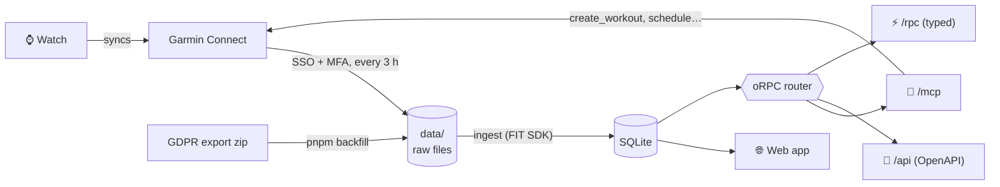

<div align="center">

# ⌚ garmin

**Your Garmin data, on your own server.**
Garmin Connect synced into SQLite, a small web app to look at it, and an MCP that lets Claude read
it and write workouts to your watch.

[](https://github.com/vafanassieff/garmin/actions/workflows/ci.yml)


</div>

---

## ✨ What it does

|     |                                                                                                                                                                                                                         |
| --- | ----------------------------------------------------------------------------------------------------------------------------------------------------------------------------------------------------------------------- |
| 🔄  | **Syncs Garmin Connect by itself.** Logs in like the mobile app (SSO + MFA), keeps only its tokens, and pulls activities, sleep, HRV, readiness, weigh-ins and the calendar every 3 hours. The whole history on demand. |
| 📊  | **A web app to look at it.** Stats, runs, every activity with its route and its curves, sleep night by night. Plain SVG charts, light and dark.                                                                         |
| 🤖  | **An MCP for Claude.** 15 tools: list and compare runs, a morning readiness check, training load, the planned workouts, and read-only SQL on everything.                                                                |
| 🏃  | **Workouts on the watch.** Claude creates, schedules, moves and deletes structured workouts: paces like `"6'05/km"`, HR in bpm, repeat groups, strength circuits from Garmin's catalog. Every write has a dry run.      |
| 🧩  | **One API, three faces.** One [oRPC](https://orpc.dev) router serves the MCP (`/mcp`), OpenAPI (`/api`) and a typed RPC client (`/rpc`).                                                                                |
| 🔐  | **Private by design.** One password, or OAuth 2.1 for MCP clients. Raw files and SQLite on your disk, never in git; every secret in its own 0600 file.                                                                  |

TypeScript and [Effect](https://effect.website) end to end, with no Python. The web app runs on
TanStack Start + React, the data on drizzle + `node:sqlite`, and FIT files go through Garmin's
own FIT SDK.

## 🏗️ How it works



- **Raw files are the source of truth.** The FIT files and Garmin Connect's JSON stay on disk.
  The database can always be rebuilt from them (`pnpm ingest --rebuild`).
- **The app owns the Garmin account.** You log in once on `/garmin` (email, password, MFA code).
  The access token is refreshed before it expires. If Garmin ever refuses the session, the web
  app and the MCP say so.
- **Writes go straight to Garmin.** After a write, the calendar months it touched are fetched
  again, so `planned_workouts` reads back exactly what the watch gets.

## 🚀 Quick start

One image, `ghcr.io/vafanassieff/garmin`, with two volumes. It holds health data, so run it on a
private network (Tailscale, say), behind a reverse proxy that terminates TLS.

```yaml
garmin:
  image: ghcr.io/vafanassieff/garmin:latest
  restart: unless-stopped
  volumes:
    - ./garmin/data:/data # raw files, SQLite
    - ./garmin/session:/session # Garmin tokens, password hash, OAuth database
  environment:
    TZ: Europe/Paris
```

1. **Create both directories**, owned by uid 1000, in 0700. The app creates every file 0600.
2. **Open `/setup` right away** and choose the app's password. Until then, whoever opens the
   app first chooses it.
3. **Log Garmin in** on `/garmin`: email, password, then the MFA code Garmin sends. The first sync
   starts at once. From a terminal instead:
   `docker exec -it <container> node src/garmin/cli.ts login`.
4. **Fetch the history**, either way:
   - the "whole history" button on `/garmin`, or
     `docker exec <container> node src/garmin/cli.ts sync --since all`;
   - Garmin's export zip dropped into `data/import/`, then
     `docker exec <container> node src/export.ts /data/import/<export>.zip`.

Every push to `main` that passes CI pushes `:latest` and `:<sha>`.

## 🤖 Connect Claude

```sh
claude mcp add --transport http garmin https://garmin.example.com/mcp
claude mcp login garmin   # the browser opens /authorize: allow it
```

Claude Code finds the app's OAuth server by itself and keeps its own tokens. `/access` lists the
apps you allowed and revokes any of them. You can also pass the app's password as a bearer
token: `--header "Authorization: Bearer <password>"`.

<details>
<summary><b>The 15 tools</b></summary>

**Your data (read-only)**

- `list_activities`, `get_activity` (laps, zones, km splits), `compare_runs`.
- `daily_readiness`, with 28-day baselines.
- `weekly_load`: acute and chronic load.
- `planned_workouts`.
- `sync_status`: the Garmin session, the last syncs, how fresh the data is.
- `schema` and `sql`: one read-only SQLite statement per call. It is enforced by SQLite itself
  (read-only connection, `query_only`, an authorizer that only allows reads) and runs in its own
  process, killed after 30 s.

**The watch** (these change the real Garmin account)

- `create_workout`: runs with pace or HR targets, warm-up, cool-down, repeat groups, and
  strength circuits checked against Garmin's catalog. It can be scheduled on dates.
- `schedule_workout`.
- `unschedule_workout`: one calendar entry, named by its id, date and exact name.
- `delete_workout`: one workout, named by its id and exact name. Nothing is ever deleted by
  pattern.
- `list_workouts` and `find_exercises` help write them.

Every write takes `dry_run: true`, which returns the exact requests and sends nothing. A write is
never retried, so a workout is never created twice. The payloads match Garmin's workout editor,
step for step.

</details>

## 🧩 API

The same procedures, wherever you need them, behind the same auth (the web session, or a bearer
token: the password or an OAuth token).

| Face    | Path                                    | For                                                                                     |
| ------- | --------------------------------------- | --------------------------------------------------------------------------------------- |
| MCP     | `/mcp`                                  | Claude and other MCP clients (streamable HTTP, stateless)                               |
| OpenAPI | `/api`, document at `/api/openapi.json` | anything REST: `GET /api/activities`, `POST /api/workouts`, `DELETE /api/workouts/{id}` |
| RPC     | `/rpc`                                  | the web pages and scripts, fully typed                                                  |

```ts
import { createORPCClient } from '@orpc/client'
import { RPCLink } from '@orpc/client/fetch'
import type { RouterClient } from '@orpc/server'

import type { Router } from './src/api/router.ts'

const garmin: RouterClient<Router> = createORPCClient(
  new RPCLink({
    origin: 'https://garmin.example.com',
    url: '/rpc',
    headers: { authorization: `Bearer ${token}` },
  })
)

await garmin.workouts.create({
  name: "Plan - tue 03/11 - Easy 40'",
  sport: 'running',
  steps: [{ duration: '40:00', hr: { low: 120, high: 150 } }],
  schedule: ['2027-01-13'],
})
```

The inputs are Effect schemas, used for both validation and JSON Schema. An error the caller can
act on answers `BAD_REQUEST` with a readable message.

## 🛠️ Development

```sh
pnpm install
pnpm dev                # :3000 (needs DATABASE_PATH and DATA_DIR; secrets default to .tokens/)
pnpm test               # vitest
pnpm check              # format, lint, types
```

| Command                                      | What                                                               |
| -------------------------------------------- | ------------------------------------------------------------------ |
| `pnpm garmin login \| status \| logout`      | the Garmin session, from a terminal                                |
| `pnpm garmin sync [--since YYYY-MM-DD\|all]` | one sync now; `all` fetches the whole history, paced               |
| `pnpm ingest [--rebuild]`                    | ingest `data/` now, or rebuild SQLite from scratch                 |
| `pnpm backfill <export.zip>`                 | import Garmin's "Export your data" zip                             |
| `pnpm db:generate <name>`                    | the next migration of `src/schema.ts` (into `drizzle/`)            |
| `pnpm db:generate:auth <name>`               | the next migration of `src/oauth/schema.ts` (into `drizzle-auth/`) |

> Garmin rate-limits logins per address: from a laptop the SSO may answer 429 (or a Cloudflare
> 403). Log in from the server's web app.

---

## 📚 Reference

<details>
<summary><b>🔐 Security</b></summary>

- **The Garmin session.** Only its OAuth2 tokens are kept, in their own file
  (`GARMIN_SESSION_PATH`, 0600 in a 0700 directory). They are never stored in SQLite (which the
  MCP's SQL reads) or in `data/`, and never logged. The Garmin password is never stored.
- **One password** guards the app.
  - It is chosen on `/setup` (12 characters at least) and changed on `/password`.
  - Only its scrypt hash is kept (`PASSWORD_PATH`).
  - Changing it logs out every other browser, the MCP and every OAuth grant.
  - Logging out ends every browser's session, a copied cookie included.
- **Throttling.** Wrong passwords are limited to 10 a minute per client, 60 a minute in all, and
  2 checks at a time.
- **Every answer** refuses a POST from another site (CSRF), and carries
  `frame-ancestors 'none'`, `nosniff`, HSTS and `no-store`.
- **OAuth 2.1 for MCP clients.**
  - Discovery (RFC 9728, RFC 8414) and dynamic registration (RFC 7591, throttled).
  - A consent page behind the web session, then PKCE S256.
  - Access tokens last an hour; refresh tokens last 30 days and are rotated at each use. A spent
    refresh token that comes back revokes its grant.
  - Grants live in their own SQLite file (`AUTH_DATABASE_PATH`, via drizzle), tokens as their
    SHA-256 only.

</details>

<details>
<summary><b>🗂️ <code>data/</code> layout</b></summary>

| Path                                       | What                                                                     | From         |
| ------------------------------------------ | ------------------------------------------------------------------------ | ------------ |
| `fit/YYYY/<activityId>.fit`                | the activity's original FIT file                                         | sync, export |
| `fit/unmatched/<file>.fit`                 | export FIT files no Garmin Connect activity matches (kept, not ingested) | export       |
| `connect/activities/YYYY/<id>.json`        | Garmin Connect's activity summary (name, load, training effect, gear)    | sync         |
| `connect/activities/YYYY/<id>.export.json` | the export's summary of the activity, used when the API's is missing     | export       |
| `connect/daily/YYYY/<date>.json`           | one day: stats, sleep, HRV, training readiness, max metrics              | sync         |
| `connect/body/YYYY-MM.json`                | a month of weigh-ins and body composition                                | sync         |
| `connect/calendar/YYYY-MM.json`            | a month of the Garmin calendar (scheduled workouts)                      | sync         |
| `connect/workouts/<workoutId>.json`        | a workout's steps                                                        | sync         |
| `export/<zip>/…`                           | the export's wellness JSON files, as extracted                           | export       |
| `garmin.db`                                | SQLite, rebuilt from the above                                           | ingest       |

</details>

<details>
<summary><b>🧮 Schema</b></summary>

Conventions:

- Timestamps are ISO 8601 UTC text, local times `YYYY-MM-DDTHH:MM:SS`, days `YYYY-MM-DD` (the
  watch's local day).
- Units are metres, seconds and m/s.

Tables and views:

- `activities`: one row per activity.
  - Its identity and time: sport, name, start (UTC and local).
  - Its effort: distance, ascent, HR, speed, cadence, power, calories.
  - Garmin's analysis: training load and effect, time in each HR zone (with the zone bounds).
  - The rest: gear, start point, and a simplified polyline for maps.
- `laps`: durations, distance, HR, speed, cadence, power, intensity, and the workout step run.
- `samples`: one row per second (lat, lon, alt, hr, speed, cadence, power, distance),
  `WITHOUT ROWID`.
- `daily`: one row per day.
  - Recovery: sleep (times, stages, score), overnight HRV and its status, resting HR, body
    battery.
  - Activity: steps, stress, intensity minutes.
  - Garmin's verdicts: training readiness, VO2max, race predictions.
- `body`: weigh-ins with body composition.
- `planned_workouts`: the Garmin calendar, with each entry's id, its workout's id and its steps.
- `raw_files`, `sync_runs`: what was ingested, and each sync with Garmin Connect.
- Views: `activity_summary` (paces, minutes, zones in minutes), `weekly` (per ISO week and sport).

</details>

<details>
<summary><b>🧱 Modules</b></summary>

```
src/
  garmin/
    sso.ts              Garmin's SSO: login (mobile, then portal), MFA, ticket → tokens, refresh
    session.ts          the session's tokens (0600), refreshed under a lock
    api.ts              Garmin Connect's API; writes never retried
    sync.ts             Garmin Connect → data/ → ingest, the 3-hour loop
    login.ts            the login's two steps, for the web and the CLI
    workout-builder.ts  workout inputs (paces, HR, durations, exercises) → Garmin's JSON
    workouts.ts         create / schedule / unschedule / delete, then refresh the calendar
    cli.ts              pnpm garmin login | status | logout | sync
  api/                  oRPC: garmin.ts (public procedures = MCP tools), web.ts (the pages'),
                        handlers.ts (/mcp, /api, /rpc), client.ts (the pages' typed client)
  oauth/                the MCP's OAuth server: schema, service, consent page, metadata
  schema.ts, db.ts      drizzle schema and the SQLite connection, migrated at startup
  fit.ts, connect.ts    FIT files and Garmin Connect's JSON → rows
  ingest.ts, export.ts  data/ → SQLite; the GDPR export zip → data/
  reader.ts             the MCP's read-only SQL, in a child process killed past 30 s
  tools.ts, stats.ts    the MCP's and the web pages' queries
  auth.ts               the password, the session cookie, the gate in front of everything
  routes/               TanStack Start pages and endpoints
  components/           the pages' charts (plain SVG) and formats
```

</details>

<details>
<summary><b>🌐 Web pages</b></summary>

- `/`: the connection at a glance and the last 7 days against the 7 before. The last night.
  Hours per week by sport, and HRV, resting HR and sleep over 28 days.
- `/runs`: running over 26 or 52 weeks, or all of it.
  - Volume: km per week and the time per HR zone.
  - Each run's pace, and the longest run.
  - VO2max and race predictions.
- `/activities`, `/activities/$id`: every activity, then one in full.
  - Its numbers and its route (drawn from its polyline, no map tiles).
  - Its pace, HR and altitude on one crosshair.
  - Its kilometres and laps.
- `/sleep`: over 30, 90 or 365 nights, or all of them.
  - The last night.
  - The period against the one before.
  - The stages and the schedule night by night.
  - HRV against its baseline, and body battery.
- `/garmin`: the connection, the login, sync now, the whole history, and the last syncs.
- `/access`: the apps allowed on the MCP, each revocable.
- `/setup`, `/login`, `/password`: the app's password.

</details>
